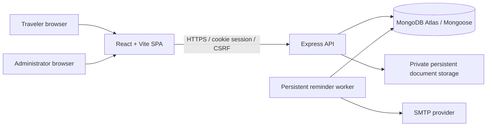

# Smart Visa & Travel Document Tracker

## Academic submission summary

- **Project title:** Smart Visa & Travel Document Tracker
- **Collaborating organization:** Unified Mentor
- **Project type:** Academic full-stack application
- **Live website / API:** Not deployed; no live URLs are available yet.
- **Repository:** No Git repository or remote is configured in the current project folder.

## Project overview

The application is designed to help travelers organize travel documents, review expiry dates, prepare destination checklists, record trips, manage reminder preferences, and contact support. Administrators can review aggregate usage and manage users, destination requirements, notifications, and support queries.

## Problem statement

Travelers may keep visas, passports, insurance, vaccination information, travel plans, and official destination requirements in separate places. Important document dates and preparation tasks can be overlooked. The project provides one workspace for recording that information and surfacing reminders and informational warnings.

## Objectives

1. Provide authenticated traveler and administrator workspaces.
2. Store document metadata and travel history in owner-scoped records.
3. Keep private attachments outside MongoDB and serve them only through authorized API routes.
4. Calculate expiry status consistently on the backend.
5. Schedule reminder emails independently of user sessions.
6. Present destination requirements with source and verification information.
7. Record important system and administrator activity without sensitive field values.

## Scope

Implemented modules include account registration/login/logout, role-based routes, traveler dashboard, profile settings, document management, private local file storage, expiry tracking, reminders/notifications, travel history, destination checklist, support queries, administrator analytics/user management, and audit activity. The application does not determine legal immigration eligibility or guarantee visa entry. Reminder and overstay warnings depend on user-entered data and official rules must be confirmed with the relevant government authority.

## Functional requirements

- Register/login/logout with hashed passwords and cookie-based JWT authentication.
- Traveler CRUD for document metadata, attachments, trips, profile data, reminders, and support conversations.
- Expiry summaries and informational potential-overstay alerts.
- Scheduled notification creation, deduplication, email attempts, and delivery history.
- Destination requirement browsing and administrator CRUD.
- Administrator summary analytics, user search/status management, notification monitoring, support responses, and audit-event review.

## Non-functional requirements

- Server-side authentication, authorization, and record ownership checks.
- Private file access and data-minimized responses/logs.
- Responsive React layouts, accessible labels, keyboard focus, and consistent status presentation.
- Paginated list APIs, bounded uploads/request bodies, safe error responses, and graceful process shutdown.
- UTC timestamp storage with calendar-date handling for expiry calculations.

## Architecture



The API owns validation, authentication, authorization, and business rules. MongoDB stores structured records; the browser never receives a JWT in local storage. A dedicated worker scans for reminders and processes due notification records. In the prepared Render configuration, the API and worker are separate services; the worker is not a serverless function.

## Technology stack

- Frontend: React, Vite, JavaScript, Tailwind CSS, React Router, Axios.
- Backend: Node.js, Express.js, JavaScript.
- Data: MongoDB Atlas and Mongoose.
- Security: bcryptjs, JWT, HttpOnly cookies, CSRF token, Helmet, CORS, express-rate-limit.
- Email/jobs: Nodemailer and a persistent Node.js worker with scheduled scans and retry processing.
- Tests: Node test runner and Supertest for backend; Vite production build. A frontend Vitest setup is not currently installed.
- Planned hosting: Vercel frontend; Render API and background worker.

## Folder structure

```text
smart-visa-travel-tracker/
  frontend/src/          React pages, layouts, routes, context, UI, API services
  frontend/public/        Static public assets
  backend/src/config/     Environment and database configuration
  backend/src/models/     Mongoose schemas and enums
  backend/src/routes/     Authentication, traveler, and admin APIs
  backend/src/services/   Expiry, dashboard, storage, audit, and notification logic
  backend/src/jobs/       Persistent reminder worker
  backend/tests/          Backend tests
  README.md               Setup, features, and API details
  SECURITY.md             Security review and known risks
  QA-REPORT.md            Part 15 executed tests and gaps
  DEPLOYMENT.md           Part 16 deployment preparation and manual steps
  render.yaml             Render API/worker infrastructure template
```

## Database design

| Collection | Purpose | Main relationships |
| --- | --- | --- |
| Users | Account, role, status, profile and reminder preferences | Parent of the user's documents, trips, notifications and support requests |
| TravelDocuments | Safe metadata and references to private attachments | Owned by a user; referenced by trips and notifications |
| TravelHistory | Planned/past trips, destinations, dates, purpose and user-recorded entry/exit | Owned by a user; may reference owned visa/document records |
| Notifications | Scheduled email state, retries, idempotency and safe delivery errors | Owned by a user; may refer to a document or trip |
| DestinationRequirements | Official-source checklist items by destination/nationality/purpose | Last updated by an administrator |
| SupportQueries | User conversations and support status | Owned by a user when authenticated; responses include author references |
| AuditLogs | Append-oriented action, actor, resource, time and safe field labels | Actor/resource references where available |

Indexes support unique email, owner/date searches, expiry filtering, notification due processing/deduplication, and audit review. Uploaded file bytes are not stored in MongoDB.

## API documentation

All API routes are prefixed with `/api`. Mutating cookie-authenticated requests require the CSRF token. Traveler routes derive ownership from the session. Administrator APIs require the server-side admin role.

| API group | Base path | Purpose |
| --- | --- | --- |
| Health | `/api/health` | Service and database status |
| Authentication | `/api/auth` | CSRF initialization, register, login, logout, current session |
| Documents | `/api/traveler/documents` | Metadata CRUD, upload/download, status |
| Expiry | `/api/traveler/documents/expiry` | Summary, upcoming/expired items, informational warnings |
| Dashboard | `/api/traveler/dashboard` | Authenticated traveler aggregates and recent records |
| Reminders/notifications | `/api/traveler/notifications` | Preferences, upcoming notices, history, read state |
| Travel history | `/api/traveler/travel-history` | Owned trip CRUD and filtering |
| Destination checklist | `/api/traveler/destinations` | Search and generate date-aware checklist |
| Profile | `/api/traveler/profile` | Read/update own profile and change password |
| Support | `/api/traveler/support` | Create/view/reply to own support queries |
| Administration | `/api/admin` | Dashboard, activity, user state, notifications, destinations, support |

Detailed method/path/filter tables are maintained in [README.md](./README.md) with the corresponding feature documentation.

## Authentication workflow

1. Browser obtains a CSRF token and sends it in a request header for mutations.
2. Registration validates name/email/password, sets role to traveler, and stores a bcrypt hash.
3. Login verifies credentials and returns a short-lived JWT in an HttpOnly cookie.
4. On later requests, the server verifies JWT signature, issuer, audience, expiry, and current account status in MongoDB.
5. Protected route middleware checks traveler/admin role; record queries still scope to the authenticated owner.
6. Logout clears session and CSRF cookies. The frontend keeps no JWT in local storage.

## Expiry tracking workflow

The backend compares UTC calendar days and configured warning thresholds (90/60/30 by default) to calculate remaining days, valid, expiring-soon, expired, pending-information, and visa-not-yet-valid states. A visa's valid-from and expiry dates are separate. Document validity does not itself mean entry eligibility.

## Reminder scheduling workflow

The persistent worker scans eligible records based on user preferences and timezone, creates idempotent notification records, atomically claims due work, sends via SMTP, and records safe status/error metadata with bounded retries. It can resume queued work after restart. SMTP acceptance plus database recording is not atomic, so at-least-once delivery can produce a rare duplicate.

## Destination checklist workflow

The traveler selects destination, nationality, purpose, and travel dates. The backend filters active destination requirements and compares them cautiously with the traveler’s own saved document metadata. Entries retain official source URLs and verification timestamps. Checklist data is informational and requires user verification.

## Administrator workflow

Administrators view real aggregate counts, search/paginate traveler accounts, suspend/reactivate travelers, monitor safe notification delivery data, manage destination requirement records, review support threads, and inspect audit events. Admins are not given password hashes or private document file paths through these screens. Sensitive actions are audited using safe metadata.

## Security architecture

The API uses Helmet, restricted credentialed CORS, HttpOnly JWT cookies, CSRF checks, role middleware, owner-scoped queries, rate limits, bounded JSON bodies, safe error responses, password hashing, upload type/signature checks, and private authenticated file streaming. Production secrets belong in hosting-provider secret settings. See [SECURITY.md](./SECURITY.md) for limitations and release gates.

## Installation and local development

Requirements: Node.js 20.19+ (or 22.12+) and npm.

```sh
npm run install:all
```

Copy `frontend/.env.example` to `frontend/.env` and `backend/.env.example` to `backend/.env`, then set local values. Start in separate terminals:

```sh
npm run dev:backend
npm run dev:frontend
npm run dev:worker
```

The browser uses `http://localhost:5173`; the local health endpoint is `http://localhost:5000/api/health`. The worker needs a reachable MongoDB and SMTP test transport/configuration.

## Testing methodology and results

The backend Node test runner/Supertest suite uses isolated test fixtures and currently reports **67 passed, 0 failed**. The frontend Vite production build passed. One browser smoke inspection confirmed the public landing page renders. Frontend component/E2E automation, live database integration, production SMTP, all route interactions, and exact responsive viewport checks were not completed. Read [QA-REPORT.md](./QA-REPORT.md) for case-level results and gaps.

## Deployment architecture

The prepared Vercel configuration enables SPA deep links and security headers. The Render Blueprint defines a persistent Node API, private mounted document disk, and separate worker. Production has not been deployed: Atlas connection currently fails, SMTP and provider account configuration are missing, and this workspace has no Git remote. Follow [DEPLOYMENT.md](./DEPLOYMENT.md). No live website/API URL is claimed.

## User guide

1. Register as a traveler, then sign in.
2. Add document metadata and upload a synthetic/private attachment using the supported file formats.
3. Review calculated expiry status and configure notification intervals/timezone.
4. Record planned or past trips, then create a destination checklist using official-source references.
5. Update profile preferences or send a support request; review replies and notifications from their pages.
6. Use sign out when finished. Do not upload real passport or visa images to an unverified deployment.

## Administrator guide

An administrator account is created through the controlled seed script using environment variables, not public registration. Sign in with that account to review dashboard statistics, search/suspend/reactivate traveler accounts, manage destination requirements, inspect safe notification results, respond to support, and review activity. Only seed an admin in a verified, authorized environment.

## Known limitations

- Deployment is incomplete; Atlas cannot currently be reached, SMTP is unset, and hosting credentials/repository linking are needed.
- The prepared Render disk is private and persistent but single-instance and not object storage; backup/restore has not been verified.
- A shared rate-limit store, monitoring/alerting, audit retention policy, notification retention, orphan reconciliation, and account export/deletion workflow remain future work.
- No independent penetration test or full responsive/accessibility audit has been completed.
- Email can be delivered at least once, with a rare retry duplicate around an SMTP/database failure.
- Visa and potential-overstay indicators are informational only and depend on user input.

## Future enhancements

- Implement private object storage with lifecycle, encryption, backup, and malware scanning.
- Add frontend Vitest and browser-based end-to-end suite, plus automated accessibility and responsive checks.
- Add staging/production separation, CI, dependency scanning, centralized metrics/alerts, and shared rate limiting.
- Define compliant data export/deletion and audit/notification retention workflows.
- Add email verification, account recovery, and secure session revocation.
- Improve requirement source freshness review and expand localizations.
